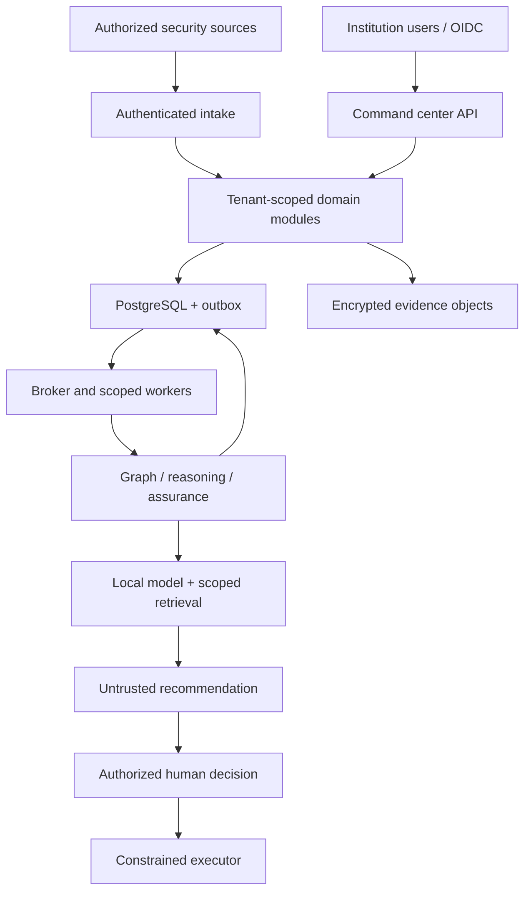

# QASCP 2.0 — Architecture and decision records

Proposed P1 design dated 2026-11-15. [PRD](../product/QASCP_2_PRD.md), [contracts](QASCP_2_CONTRACTS.md), [threats](QASCP_2_THREATS.md), [authority and supersession](QASCP_2_SUPERSESSION.md). Requirements: PRD-01..10; QASCP-GOV-002, QASCP-SEC-001..005, QASCP-AI-001..002, QASCP-ENG-002. Review: P1-V02. All ADRs below are proposed, authored by the implementation agent from the owner's supplied vision; actual owner approval and independent review are pending.

## Components and trust boundaries

This diagram shows logical responsibility, not separate microservices. FastAPI modules share a deployment initially, with explicit interfaces and ownership. Customer records always require trusted tenant context. Liveness is isolated and cannot query customer data. Identity, integration, persistence, AI, evidence and execution boundaries from [P1](P1_ARCHITECTURE.md) remain applicable.

Modules: tenancy/authorization, inventory, identity metadata, intake/connectors, graph, findings/cases, reasoning, assurance, AI governance, approval/workflow, evidence/audit, applicability/reporting. Domain code owns writes; reporting and graph projections cannot bypass source authorization. Module dependencies go through services and versioned events, rather than arbitrary table writes.

## Four original engines

| Engine | Input and output | Failure semantics |
|---|---|---|
| Security Knowledge Graph | Normalized observations → typed, attributable, time-bounded nodes/edges | Ambiguous identity remains unresolved; never merge on display name alone |
| Contextual Security Reasoning | Versioned facts + deterministic rules → ranking, explanation, missing-context flags | Unknown is distinct from safe; optional local AI summarizes evidence but cannot supply missing facts |
| Continuous Assurance | Evidence/policy changes + dependency index → assertion transitions and re-verification jobs | Incomplete dependency coverage or source watermark gaps trigger conservative scoped reconciliation |
| Decision & Response Orchestrator | Versioned proposal + exact approval → auditable constrained executor request | P4 uses synthetic operations to prove default deny on absent, changed, cross-tenant, expired, revoked, replayed, reused or stale-authority approval; no model production credentials. P5 adds full assurance and operational integrations |

Reasoning initially orders by policy-defined impact band, confirmed exposure and observation freshness, preserving component values and rule version. Do not invent a calibrated numeric risk score. AI suggestions are stored separately from deterministic output and attributed human decisions. Assurance states are unassessed, supported, needs_verification and failed; a source outage cannot by itself prove a failed control. Concurrent updates use expected versions to reject stale decisions.

## Architecture decisions

Each record uses original requirements from the supplied vision and current repository; no external implementation or proprietary taxonomy adopted. Product/tool documentation is reference material only; dependency licenses and pinned versions require adoption review at P2. Sources: [source register](../governance/REGULATORY_SOURCES.md); reference applicability and rights remain pending where recorded there.

| ADR | Choice and alternatives | Consequences and reconsideration |
|---|---|---|
| ADR-2-001 | FastAPI modular monolith + PostgreSQL; alternative early microservices | One transaction boundary and simpler deployment; module coupling reviewed. Split only on measured scaling or fault-isolation needs. Refines ADR-001 |
| ADR-2-002 | PostgreSQL nodes/typed edges first; alternatives Neo4j or graph-only system | Composite tenant keys/FKs and RLS preserve consistency. Evaluate Neo4j after bounded query benchmarks fail agreed targets, including isolation and rebuild cost. Refines ADR-005 |
| ADR-2-003 | Transactional outbox + broker/workers when async delivery starts; alternatives in-process tasks or direct dual writes | DB commit owns record and outbox. Publisher retries, consumer idempotency and dead-letter handling required. At-least-once delivery, no claim of exactly-once transport |
| ADR-2-004 | S3-compatible encrypted evidence storage; alternative DB blobs | DB retains scoped metadata/hash; object access rechecks policy. Orphan reconciliation, retention and restore tests required. Refines ADR-003 |
| ADR-2-005 | Local model + tenant-scoped retrieval + deterministic rules; alternative remote-only reasoning | Locality does not replace authorization or injection controls; model/prompt/policy/input versions retained. Model availability cannot block deterministic intake |
| ADR-2-006 | OIDC/SSO, MFA policy, RBAC plus resource attributes; alternative local password system | Validate issuer/audience/signature/expiry; roles do not override tenant membership. Separate workload credentials and privileged administration |
| ADR-2-007 | PostgreSQL indexed search first; OpenSearch deferred | Reduce secondary data copies; introduce only with measured need and tenant-filter/rebuild/deletion evidence |
| ADR-2-008 | OpenTelemetry traces and Prometheus operational metrics | Exclude customer payloads, secrets and high-cardinality identity labels. Private-cloud/on-prem packaging with controlled egress; readiness tracks dependencies without leaking tenant content |

## Reliability and security invariants

Tenant IDs are obtained from validated membership or connector registration, never trusted from payloads. The API authorization service establishes user context, the connector authorization service establishes intake context, and the worker authorization service reconstructs current workload context under the versioned [trusted-context contract](../../contracts/qascp-2/trusted-context.schema.json). Database application roles have no BYPASSRLS or ownership privileges. Foreign keys include tenant_id for every tenant-owned endpoint. Apply context within a transaction and clear it before pooled reuse. Partitioned indexes, object references, graph traversal, AI retrieval and queue retries enforce the same tenant policy.

Commit intake metadata, the adapter-computed received-payload digest, audit and outbox atomically. The [audit](../../contracts/qascp-2/audit-event.schema.json), [outbox](../../contracts/qascp-2/outbox-event.schema.json), [receipt](../../contracts/qascp-2/consumer-receipt.schema.json) and [delivery](../../contracts/qascp-2/delivery-envelope.schema.json) contracts preserve tenant, authorization, input version and correlation. Workers authenticate producer, reauthorize current service scope and deduplicate by tenant/job purpose/input version. Retry transient errors with bounded backoff; schema or tenant failures are quarantined without public payload disclosure. Dead-letter ownership, alerting and authorized replay are explicit operational responsibilities. Do not mark an event projected until graph writes and consumer receipt commit together. A source watermark means a defined connector checkpoint, not merely the latest timestamp seen.

Evidence collection stores digest, collector, content type, size, purpose and retention; hashes alone do not prove truth or complete custody. Deletion policy covers objects, indexes, caches, exports and backups as applicable. Audit events use restricted append-only storage, integrity monitoring and separately controlled retention. Integrity design and restore results require P5/P6 evidence.

Response approvals follow the versioned [approval lifecycle contract](../../contracts/qascp-2/approval-lifecycle.schema.json) and bind tenant, proposal ID/version, target, canonical parameter digest, approving actor, authorization version, expiry and allowed action. The P4 constrained executor rechecks entitlement immediately before a synthetic execution, writes required audit and consumes approval atomically, and uses a downstream idempotency key. After an ambiguous timeout or partial result it records an indeterminate result and requires reconciliation before retry. Revocation, consumption, execution failure, partial execution and reconciliation remain visible in append-only case history. P5 operational integrations inherit this boundary.

## Delivery boundary

P1 delivers design and static contracts only. P2 introduces authenticated inventory/identity/event/graph foundations and audit with synthetic fixtures and a real test PostgreSQL. P3 adds correlation and contextual rules. P4 adds AI evaluation, exact human approval and a constrained executor boundary exercised only with synthetic operations, including denial and lifecycle tests required by the governance gate. P5 adds full assurance workflows, evidence custody, remote reconciliation and separately authorized operational integrations. P6 covers deployment and independent validation. No queue, search engine, model server or customer connector is claimed operational here.
