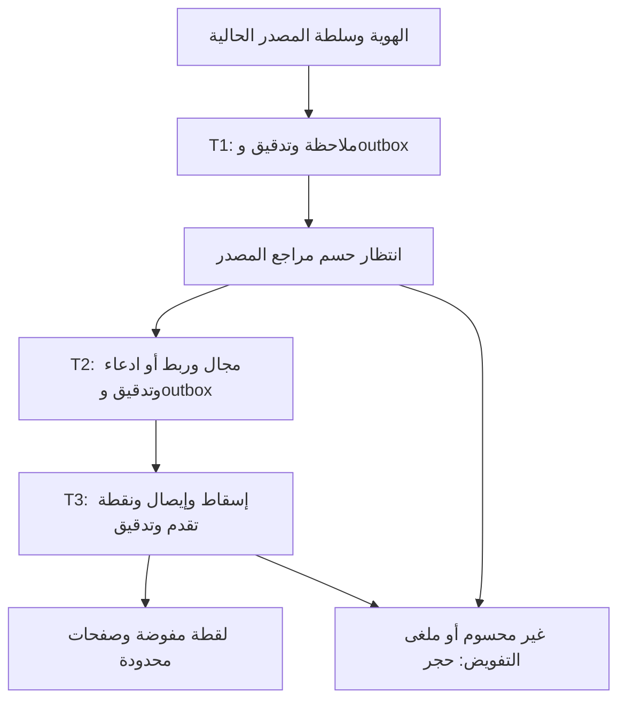

# QASCP 2.0 — مخطط تخزين ومعاملات BANK-01

[English](QASCP_2_BANK01_BLUEPRINT.md). مقترح تصميم ضمن P1 بتاريخ 16 نوفمبر 2026 بتوقيت قطر؛ V2-P1-02 / P1-V02. تعرض النسختان المقترح نفسه. هذه تهيئة من المنفّذ للمراجعة، وليست تقييمًا مستقلًا أو ترحيلًا معتمدًا أو خدمة تشغيلية أو اعتمادًا للمرحلة. يظل [سجل المرحلة](../verification/README.md) المرجع: P1 / Pending review.

المتطلبات: PRD-01 وPRD-02 وPRD-08 وPRD-09 وPRD-10؛ QASCP-SEC-001..005 وQASCP-GOV-001..004 وQASCP-ENG-001..003. يفصّل المقترح G-01..G-06 في [قرارات الرسم](QASCP_2_GRAPH_DECISIONS.md). المسارات المتأثرة: ربط مصادر الموارد، وتهيئة الملاحظات، والاستيراد، وتسلسل العلاقات، والإيصالات، واللقطات، والتدقيق. لا تتغير هنا العقود العامة أو الصلاحيات أو بوابات المراحل أو متطلبات الحوكمة.

قبول المقترح في P1 يتطلب مراجعة مستقلة للملكية والقيود والمعاملات والفشل ومصفوفة القبول أدناه، وحسم التوافق وتعيين أشخاص فعليين قبل الاعتماد. الاختبار التشغيلي ضمن V2-P2-01..06 بعد اعتماد خروج P1. لا يُعرض أي اختبار مستقبلي أدناه باعتباره منفذًا.

## B01 — النطاق واختيار العقود

تُراجع [مقترحات الاستيراد](QASCP_2_GRAPH_IMPORT_CONTRACTS.md) و[إيصالات المعالجة والتاريخ](QASCP_2_GRAPH_RECORD_CONTRACTS.md) و[حدود API 0.2](QASCP_2_GRAPH_BOUNDARY.md) معًا. يبقى API الأصلي والإيصال 1.0 محفوظين. العقد اللاحق مرشح يتطلب اعتمادًا صريحًا ومراجعة توافق العملاء. دليل التحقق الساكن الكامل في [PR #11](https://github.com/ManeaAl-Shabrain/QASCP/pull/11) يخص النسخة 81ce4ef83abb331934bfac2ab36807bae3cbcb0d؛ لا يثبت صحة هذا المخطط الأحدث أو تنفيذ الخدمة.

يجوز أن تنفذ P2 الأصول والهويات والأحداث وادعاءات المصادر واستعراض الجوار المحدود. نتيجة الصلاحيات الزائدة وربط القضية ضمن P3؛ سجل نظام AI والموافقات والتنفيذ ضمن P4؛ والضمان والتاريخ والتصدير ضمن P5. لا تستنتج P2 نتيجة أمنية من صلاحية ممنوحة، ولا تعتبر اتصال الرسم دليل اختراق.

## B02 — التخزين المنطقي والملكية

الأسماء التالية تخطيطية. تحمل المفاتيح الأساسية والأجنبية للبيانات المؤسسية tenant_id دائمًا. تمتلك وحدات المجالات السجلات الأصلية؛ ويمتلك مسقط الرسم نموذج قراءة قابلًا لإعادة البناء.

| السجل والمالك | المفتاح المقترح وثابت الالتزام |
|---|---|
| سجل الموارد / سجل المجالات | PK (tenant_id, id)، ومفتاح فريد (tenant_id, id, kind)؛ النوع ثابت. يجب وجود سجل مجال أصلي واحد مطابق عند الالتزام؛ ترفض فحوص التكامل المؤجلة السجل الناقص أو غير المطابق. |
| الأصل والهوية والحدث / الجرد أو الإدخال | PK (tenant_id, id)، ونوع ثابت، وFK مركب إلى سجل الموارد. الأنواع الثلاثة ضمن P2؛ يرفض النوع الخاص بمرحلة لاحقة قبل إنشاء سجل المورد. |
| تسجيل الموصل / التكامل | هوية المؤسسة والموصل وقدراته الحالية؛ تحسم خدمة التفويض ربط هوية العمل. لا يمنح connector_id أو محدد المؤسسة القادم من العميل سلطة. |
| ربط المصدر / الجرد | المؤسسة والموصل والنوع وsource_id وجيل الربط؛ مراجع المورد والموصل داخل المؤسسة نفسها. ربط نشط واحد كحد أقصى لكل مفتاح مصدر. إعادة التعيين تغلق الفترة السابقة بقرار مستقل مفوض؛ الاستيراد المعتاد لا يعيد الربط. |
| الملاحظة / الإدخال | تفرد (tenant_id, connector_id, source_event_id)؛ بصمة بايتات الطلب والمراجع المطبعة غير قابلة لإعادة الكتابة. يلتزم الحدث وسجل مجاله ومورده معًا. المراجع غير المحسومة داخل التسجيل نفسه عمل معلّق صريح. |
| أمر الاستيراد / المجال المالك | تفرد (tenant_id, connector_id, command_id) عبر عائلتي الاستيراد؛ الاحتفاظ بالبصمة والعائلة والإيصال. تعيد البايتات نفسها الإيصال السابق بعد إعادة التفويض الحالي؛ وتعارض البصمة المختلفة. |
| سلسلة الادعاء وإصداره وانتقاله / مجال الرسم | تفرد السلسلة (tenant_id, connector_id, source_claim_id)، والإصدار (tenant_id, claim_id, version). مراجع الأطراف والدليل داخل المؤسسة؛ تسلسل مضبوط بـexpected_version؛ إصدارات وانتقالات ثابتة وسحب نهائي وفق 0.1. |
| التدقيق وoutbox / معاملة المجال | المؤسسة والمورد وإصداره والفاعل وتفويضه الحالي ومعرّف الربط. التدقيق المطلوب وتغيير المجال وoutbox التزام واحد. يعيد المرسل محاولة النشر دون إنشاء أثر مجال ثانٍ. |
| جيل الإسقاط والحافة ونقطة التقدم / المسقط | كل مرجع مربوط بالمؤسسة والجيل؛ قيود الأطراف والمنشأ داخل المؤسسة نفسها. لا تتقدم نقطة المعالجة إلا مع آثار الإسقاط وإيصالها. |
| إيصال المستهلك / المسقط | UUID الإيصال هو هوية المحاولة. إيصال processed واحد كحد أقصى للمفتاح (tenant_id, event_id, logical_consumer_id, consumer_version, purpose, input_version). تُحفظ محاولات failed وquarantined وduplicate منفصلة؛ ويشير duplicate إلى processed بالمفتاح نفسه. |
| اللقطة / خدمة الاستعلام | المؤسسة والفاعل وإصدار التفويض والجيل وحد المعرفة والانتهاء؛ مجموعة مرئية ثابتة محددة النطاق أو اختيار محدد الإصدار يمكن إعادة إنتاجه بصورة مكافئة. لا تبقى معاملة DB مفتوحة بين صفحات HTTP. |

هوية ربط المصدر تختلف عن سلسلة الادعاء: source_id يحدد موردًا لدى مصدر، وsource_claim_id يحدد سلسلة علاقة منسوبة إلى مصدرها. لا يُشتق أي منهما من اسم العرض. حدث مختلف بالإصدار نفسه من مخطط الإدخال يُعالج مستقلًا.

لا تملك أدوار التطبيق الجداول ولا تتجاوز RLS؛ وتنفصل بيانات اعتماد الترحيل. تغطي السياسات USING وWITH CHECK، وتحمل عمليات الربط والمراجع مفاتيح المؤسسة. يُضبط سياق المؤسسة داخل المعاملة بعد تحقق موثوق من العضوية أو هوية العمل، ويعاد ضبطه عند إعادة استخدام الاتصال. إعداد جلسة وحده ليس مصادقة ولا يحمي من مهاجم يحمل بيانات اعتماد قاعدة تطبيق غير مقيدة. يجب تقييد SQL وبيانات الاعتماد ومراجعة نموذج الثقة مستقلًا. يحسم مسار تفويض معزول العضوية الأولية، دون قدرة على استعلام بيانات مؤسسات اعتباطية.

## B03 — المعاملات وحدود التعطل

| المعاملة | سلوك النجاح والفشل |
|---|---|
| T1 إدخال الملاحظة | مصادقة وربط المصدر وضبط الحجم وفك الترميز وحساب البصمة والتحقق؛ ثم التزام الملاحظة والحدث وسجل المورد والتدقيق وoutbox. المراجع المعلقة لا تنشئ موارد. يعني 201 قبولًا دائمًا. لا يُعاد نجاح عند فشل الالتزام؛ وبعد مهلة اتصال مبهمة يعاد المفتاح والبايتات نفسيهما. |
| T2 استيراد المورد أو العلاقة | إعادة تفويض التسجيل والقدرة، والتحقق من دليل موجود ومسموح، ثم قفل أو تسلسل هوية المصدر أو expected_version؛ والتزام التغيير والإيصال والتدقيق وoutbox. أمر جديد بإصدار متوقع قديم يتعارض. تنافس المصادر على الصفات يتطلب سياسة سلطة حقول مراجعة؛ لا يفوز آخر كاتب تلقائيًا. |
| T3 الإسقاط | إعادة بناء تفويض هوية العمل قبل قراءة الحمولة؛ وتسلسل مفتاح المعالجة المنطقي؛ ثم التزام آثار الإسقاط والإيصال processed والتدقيق ونقطة التقدم معًا. التعطل قبل الالتزام لا يترك أثرًا معالجًا؛ وبعد الالتزام وقبل الإقرار يُعاد الرجوع إلى الإيصال. العمل غير المفوض أو غير الصالح لا يحصل على processed ولا يرفع نقطة تقدمه. |
| صفحات الاستعلام | تفويض الجذر والعقد والحواف والمنشأ قبل التوسع والعد والترتيب والصفحات. ربط المؤشر بالفاعل والتفويض الحالي والاستعلام واللقطة، وإعادة الفحص لكل صفحة. لا تربط عقدة مخفية بين طرفين ظاهرين. يعاد خطأ أو طلب بداية جديدة عند الانتهاء أو تغير التفويض أو نفاد الميزانية. |

ليست T1 وT2 وT3 معاملة موزعة واحدة. تقر كل منها بنتيجتها الدائمة فقط. إذا تعذر التدقيق يُحجب نجاح العملية الحساسة وتتراجع معاملتها. تستبعد سجلات المحاولات الفاشلة الحمولة المقيدة؛ وإذا تعذر تسجيلها يظهر الفشل التشغيلي بدل اختلاق معرّف تدقيق. بعد نتيجة نقل مبهمة، يُقرأ أو يعاد الطلب بمفتاح منع التكرار المفوض قبل إنشاء أمر جديد.

إقرار outbox يثبت الإرسال فقط، ولا يثبت اكتمال المستهلك. يمكن لمسقط دائم مضبوط قراءة العمل المعلق في P2؛ ويبقى الوسيط والعمال ضمن P3. لا تستبدل مهمة متطايرة التسليم الدائم. يتطلب الحجر وإعادة المطابقة صلاحية مشغل حالية وتسلسلًا محفوظًا وتدقيقًا؛ ولا يعيدان استهلاك موافقة أو إجراء إنتاجي.

## B04 — قرارات المصدر والزمن والأجيال

recorded_at الذي تضبطه الخدمة هو زمن المعرفة؛ وفترات المصدر نصف مفتوحة. لا تحدد ساعة المصدر ترتيب الالتزام. يخصص موضع داخلي متزايد داخل تدفق معاملات كل مؤسسة وجيل؛ وتربط نقاط التقدم واللقطات بهذا الموضع إلى جانب وقت العرض. هذه بيانات تخطيط داخلية لا تضيف حقلًا للعقد العام. لا يُدعى اكتمال العرض التاريخي عند تساوي الأوقات قبل مراجعة عقد ترتيب التعادل واختبارات P5.

تكتب إعادة البناء بإصدار مستهلك جديد في جيل معزول. تُراجع نقاط المصدر وتوافق المخطط وإعادة المعالجة المفوضة والنتائج المتوقعة قبل تنشيط الجيل ذريًا. تبقى المؤشرات القديمة على جيل محفوظ ومفوض أو تتلقى خطأ إعادة البداية؛ ولا تنتقل بصمت إلى بيانات مختلطة. يتبع تقاعد الجيل انتهاء اللقطات وسياسة الاحتفاظ والحجز القانوني المعتمدة. لا يعتمد هذا المستند مدة رقمية للاحتفاظ أو إعادة التشغيل.

يُبطل الحذف أو إلغاء التفويض اللقطات والتخزين المؤقت المتأثرين، مع تطبيق السياسة على الروابط والادعاءات والكائنات والتدقيق. حفظ البصمة لا يمنح حق حفظ بيانات شخصية. يحسم المسؤول التنظيمي التزامات الاحتفاظ والحذف الفعلية؛ ويجب إعادة تطبيق قيود الوصول الحالية وقرارات الحذف بعد الاستعادة.

## B05 — مصفوفة قبول BANK-01 المخططة

تُستخدم مؤسستان اصطناعيتان A وB بأسماء عرض ومعرّفات مصدر متطابقة، ومعرّفات أصلية مختلفة. يمر قبول P2 عبر API فعلي مفوض وقاعدة PostgreSQL اختبارية فعلية وأدوار تطبيق مقيدة فعلية. تُحفظ إصدارات المخطط والترحيل والبيانات الاختبارية ومنح الأدوار وهوية العمل وSHA البناء والنتائج الفعلية. تبقى أدوات العقود الاصطناعية مدخلات انحدار ولا تستبدل هذا الاختبار.

| المعرّف | المؤثر والنتيجة المطلوبة | الحزمة الأصلية والتهديدات |
|---|---|---|
| BA01 | تسجل A مصادر اصطناعية وتقبل حدثًا غير محسوم، ثم تستورد المساعد والقاعدة والهوية وادعاءات runs_as وaccesses المفوضة، وتسقط observed_on وتقرأ الجوار المحدود. تتبع معرّفات الحدث والأمر والادعاء والإيصال والتدقيق؛ لا تختلق نتيجة أو قضية. | V2-P2-02..05؛ T03/T04 |
| BA02 | ترسل A محددات B أو معرّفاتها أو أدلتها أو أطرافها أو روابط مصادرها. يرفض API دون كشف الوجود؛ وترفض اختبارات الدور المقيد الخام القراءة والكتابة والربط والمراجع بين المؤسسات. | V2-P2-01..05؛ T01 |
| BA03 | تعيد طلبات A/B المتتابعة والمتزامنة استخدام الاتصالات؛ ولا يحتفظ التراجع أو غياب السياق أو انتهاء الهوية بوصول المؤسسة السابقة. | V2-P2-01؛ T02 |
| BA04 | المفتاح والبايتات نفسيهما أثر واحد؛ البصمة المختلفة تعارض؛ والحدث المختلف بإصدار مخطط واحد يعالج مستقلًا. ينتج العمال المتزامنون أثر processed منطقيًا واحدًا. | V2-P2-03..05؛ T03 |
| BA05 | تعطل قبل وبعد كل التزام T1/T2/T3 وقبل الإقرار. قارن المجال والتدقيق وoutbox والإيصال ونقطة التقدم؛ لا فقد لعمل مقبول ولا أثر مكرر. احقن فشل التدقيق المطلوب عند كل حد تغيير. | V2-P2-04/05؛ T03/T08 |
| BA06 | ألغ سلطة الموصل أو العامل قبل الإعادة أو الإسقاط؛ امنع قراءة الحمولة المقيدة والأثر المعالج. يبقى استخدام source_id مجددًا والربط الملتبس والدليل غير المحسوم في الحجر حتى حسم مفوض. | V2-P2-02..05؛ T03/T04 |
| BA07 | أخف عقدة وسطية أو منشأ، وعدل المؤشر، وألغ الصلاحية، وأنهِ اللقطة، وأدخل دورات وتجاوز ميزانيتي العقد والحواف المستقلتين. لا استنتاج عبر المخفي ولا عدّ مسرب ولا خلط لقطات ولا نتيجة فارغة توحي بالاكتمال. | V2-P2-03/05؛ T01/T10 |
| BA08 | استخدم مفتاح أمر واحدًا عبر عائلتي الاستيراد، وإصدارات متوقعة متزامنة، وأنواع أطراف ممنوعة، وسحب ادعاء نهائيًا. التعارض ذري والتاريخ الأصلي منسوب إلى مصدره. | V2-P2-02..05؛ T03/T04 |
| BA09 | أعد بناء جيل مع أوقات مصدر متساوية والتزامات متداخلة وتأخر وإلغاء وصول. لا تنشط نتائج ناقصة ولا تخلط الصفحات؛ احتفظ بحالة lagging أو unknown الصريحة. | V2-P2-03/05؛ T07/T08 |
| BA10 | تثبيت جديد ومسار ترحيل مدعوم بأدوار ترحيل وتشغيل منفصلة؛ تحقق من RLS والمنح وتكامل سجل المورد والمجال والتراجع السليم. لا تُعدّ الترقية غير منطبقة إلا بمبرر صريح خضع للمراجعة، عند عدم وجود إصدار سابق مدعوم. | V2-P2-01/05؛ T01/T09 |
| BA11 | تعرض واجهة الرسم والجدول العربية RTL والإنجليزية LTR معرّفات ومؤهلات وحالات ومعنى UTC متطابقة ومفوضة؛ وتفحص لوحة المفاتيح والتباين. لا تؤثر البيانات المخفية في العدّ أو الملخصات المترجمة. | V2-P2-06؛ T01/T12 |

نتيجة وقضية P3، وتوصية ومنفذ P4 الاصطناعي، وضمان وتاريخ وتصدير P5، لكل منها قبول لاحق وانحدار المراحل السابقة. لا تصرح BA01..BA11 بتلك المراحل ولا تثبت الأداء أو التعافي أو الجاهزية المؤسسية.

## B06 — قرارات المراجعة قبل التنفيذ

| القرار | المراجع الفعلي والحالة | الحسم المطلوب |
|---|---|---|
| تكامل سجل الموارد والمجال وسلطة حقول المصادر | قائد قاعدة البيانات والمجال ومراجع أمني مستقل: غير معيّنين | اعتماد القيود وأدوار الترحيل والكتابة وأولوية المصادر والتصادم وإعادة التعيين؛ وربط BA02/03/08/10 بنقاط دخول فعلية. |
| المعاملات والإيصالات ودورة اللقطة والجيل | قائد الخلفية وAPI ومراجع معماري مستقل: غير معيّنين | اعتماد T1..T3 واستعادة النتيجة المبهمة والتفرد الذري وترتيب تعادل الوقت واختيار إصدار العميل؛ ثم حفظ دليل الفشل التشغيلي لاحقًا. |
| الترجمة والنطاق التنظيمي | مراجع ثنائي اللغة ومسؤول تنظيمي: غير معيّنين | فحص التكافؤ المعنوي للنسختين، وحسم إصدارات المصادر وبنودها وانطباقها والاحتفاظ والحذف والحقوق لكل جهة؛ لا يُعتمد انطباق قانوني هنا. |
| قبول P1 وسلطة التنفيذ | مالك المنتج المخوّل: القرار معلّق | مراجعة النسخة المحددة وأدلة P1-V01..04 والمراجعة المستقلة المطلوبة وفرض الحماية على main؛ ثم تسجيل الخروج المعتمد قبل P2. |

هذا استدلال تصميم أصلي من متطلبات QASCP وعقوده. لا يضيف حزمة خارجية أو مخططًا منقولًا أو نصًا تنظيميًا أو ادعاء تفرد. تبقى سلطة [سجل التهديدات](QASCP_2_THREATS.md) و[خطة العمل الأصلية](../product/QASCP_2_BACKLOG.md) و[حزمة المراجعة](../verification/QASCP_2_P1_REVIEW_PACKAGE.md) محفوظة. BA سيناريوهات قبول ضمن الحزم الحالية، وليست خطة عمل موازية. لا تستنتج هويات أو موافقات أو قبول مخاطر أو نتائج تنفيذ من أسماء الأدوار أو هذا الجدول.
