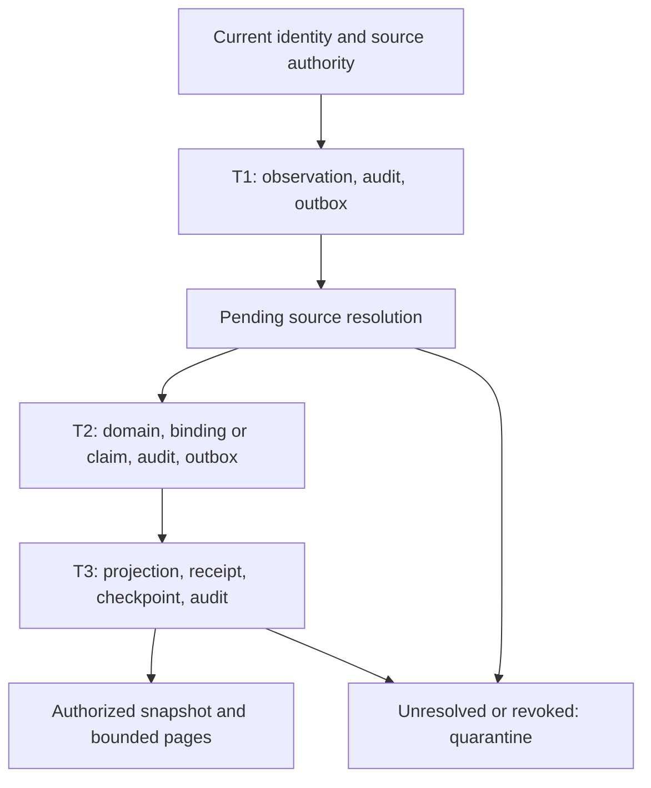

# QASCP 2.0 - BANK-01 storage and transaction blueprint

[العربية](QASCP_2_BANK01_BLUEPRINT.ar.md). Proposed P1 design, 2026-11-16 (Qatar); V2-P1-02 / P1-V02. Both editions describe the same proposal. This is implementer preparation, not an independent assessment, adopted migration, running service or phase approval. [Stage authority](../verification/README.md) remains P1 / Pending review.

Requirements: PRD-01, PRD-02, PRD-08, PRD-09, PRD-10; QASCP-SEC-001..005, QASCP-GOV-001..004, QASCP-ENG-001..003. Refines G-01..G-06 in the [graph decisions](QASCP_2_GRAPH_DECISIONS.md). Affected earlier paths: source bindings, observation bootstrap, imports, graph lineage, receipts, snapshots and audit. No public schema, permission, phase gate or governance requirement changes here.

P1 acceptance: independently review ownership, constraints, transaction boundaries, failure behavior and the planned two-tenant acceptance matrix below; reconcile compatibility and assign actual owners before approval. Runtime acceptance belongs to V2-P2-01..06 after authorized P1 exit. No future test below is reported as executed.

## B01 - Scope and contract selection

Use the versioned [import proposals](QASCP_2_GRAPH_IMPORT_CONTRACTS.md), [receipt/history proposals](QASCP_2_GRAPH_RECORD_CONTRACTS.md) and [boundary 0.2 proposal](QASCP_2_GRAPH_BOUNDARY.md) together for review. The original API and receipt 1.0 stay preserved. The successor is a candidate requiring explicit adoption and client compatibility review. Full static validation is evidenced in [PR #11](https://github.com/ManeaAl-Shabrain/QASCP/pull/11) at 81ce4ef83abb331934bfac2ab36807bae3cbcb0d; that evidence does not validate this later blueprint or an implementation.

P2 may deliver assets, identities, events, source claims and bounded neighborhood reads. BANK-01's excessive-access finding and case correlation are P3, AI-system authoring/approval execution are P4, and assurance/history/export are P5. P2 does not invent a finding from an entitlement or call a connected graph proof of compromise.

## B02 - Logical storage and ownership

Names below are logical planning names. Tenant-owned primary and foreign keys always carry tenant_id. Application modules own canonical records; the graph projector owns a rebuildable read model.

| Record / owner | Proposed key and commit invariant |
|---|---|
| Resource / domain registry | PK (tenant_id, id), unique (tenant_id, id, kind); immutable kind; exactly one matching authoritative domain row at commit. Deferred integrity checks reject missing or mismatched domain rows. |
| Asset, identity, event / inventory or intake | PK (tenant_id, id), fixed kind, composite FK to registry. All three are authorized P2 kinds; reject a later-phase kind before registry insertion. |
| Connector registration / integration | Tenant/connector identity and current capabilities; auth service resolves workload binding. A caller connector_id or tenant selector is never authority. |
| Source binding / inventory | Tenant/connector/kind/source_id plus binding generation; same-tenant resource and connector FKs; at most one active binding per source key. Reassignment closes the prior interval through a separately authorized decision; ordinary import cannot rebind it. |
| Observation / intake | Unique (tenant_id, connector_id, source_event_id); immutable received-body digest and normalized references. Event/domain/registry rows commit together. Unresolved same-registration references are explicit pending work. |
| Import command / owning domain | Unique (tenant_id, connector_id, command_id) across both import families; digest, family and receipt retained. Same bytes replay the prior receipt only after current authorization; different digest conflicts. |
| Claim lineage, version, transition / graph domain | Unique source lineage (tenant_id, connector_id, source_claim_id); unique (tenant_id, claim_id, version). Same-tenant endpoints and evidence FKs; expected-version serialization; immutable versions/transitions and terminal withdrawal per 0.1. |
| Audit and outbox / domain transaction | Tenant, resource/version, actor/current authority and correlation. Required audit, domain mutation and outbox are one commit. A dispatcher can retry publication; it cannot create a second domain effect. |
| Projection generation, edge, checkpoint / projector | Every reference includes tenant and generation; same-tenant endpoint/provenance constraints. Checkpoint advances only with the associated projection effects and receipt. |
| Consumer receipt / projector | Receipt UUID is the attempt identity. At most one processed receipt for (tenant_id, event_id, logical_consumer_id, consumer_version, purpose, input_version); retain failed/quarantined/duplicate attempts separately. A duplicate points to the processed receipt with the same logical key. |
| Snapshot / query service | Tenant, principal, authority version, generation, cutoff and expiry; scoped immutable visible set or an equivalently reproducible versioned selection. No open DB transaction across page requests. |

The source binding and claim lineage are different identities. A source_id identifies a resource at a source; source_claim_id identifies an attributable relationship lineage. Neither is derived from a display name. A different event at the same input schema version must be processed separately.

Runtime roles must not own tables or bypass RLS; migration credentials are separate. RLS policies cover USING and WITH CHECK, and tenant keys cover joins and foreign references. Transaction-local tenant context is established only after trusted membership/workload authorization and reset on pool reuse. A session setting alone is not authentication and cannot protect against an attacker holding unrestricted application database credentials. Restrict SQL/credential access and independently review the trust model. Bootstrap membership resolution uses an isolated authorization path with no arbitrary tenant-data query capability.

## B03 - Transactions and crash boundaries

| Transaction | Success and failure behavior |
|---|---|
| T1 observation intake | Authenticate, bind source, bound/decode/hash/validate bytes, then commit observation/event registry, required audit and outbox. Pending references do not create resources. 201 means durable acceptance. A failed required commit returns no success; ambiguous client timeout retries the same source key and bytes. |
| T2 resource/relationship import | Reauthorize registration/capability, require existing authorized evidence, lock/serialize source identity or expected version, then commit canonical mutation, command receipt, audit and outbox. A new command ID with a stale expected version conflicts. Competing source attributes require the separately reviewed field-authority policy; no last-writer fallback. |
| T3 projection | Reconstruct current workload context before payload access; serialize logical processing identity; atomically commit scoped projection effects, processed receipt, audit and checkpoint. A crash before commit leaves no processed effect; a crash after commit before acknowledgment replays against that receipt. Unauthorized/invalid work cannot receive a processed receipt or advance its checkpoint. |
| Query pages | Authorize root, nodes, edges and provenance before expansion/count/order/page selection. Bind cursor to principal/current authority/query/snapshot and recheck every page. Hidden intermediates never link visible endpoints. Return an explicit restart/error for expiry, changed authority or budget exhaustion. |

T1, T2 and T3 are not one distributed transaction. Each acknowledges only its own durable outcome. If audit is unavailable, a sensitive success is withheld and the relevant transaction rolls back. Failed-attempt telemetry must exclude restricted payloads; if it cannot be recorded, surface the operational failure rather than invent an audit ID. After an ambiguous transport result, read/retry by the authorized idempotency key before creating any new command.

An outbox acknowledgment only records dispatch; it does not prove consumer completion. In P2, a controlled durable projector can read pending outbox work; broker/workers remain P3. No volatile background task substitutes for durable delivery. Quarantine/reconciliation needs explicit current operator permission, retained lineage and audit; it cannot replay approval consumption or production actions.

## B04 - Source, time and generation decisions

Server-owned recorded_at is knowledge time; source-valid intervals are half-open. Source timestamps do not establish commit order. Assign an internal monotonic position within each tenant/generation transaction stream; checkpoints and snapshot selections bind that position as well as display time. This internal planning metadata does not add a public schema field. Do not claim a complete equal-time historical view until its tie-breaking contract and P5 tests are reviewed.

A consumer-version rebuild writes an isolated generation. Verify source checkpoints, schema compatibility, authorized replay and expected graph results before atomic generation activation. Old cursors retain an authorized retained generation or receive a restart error; they never silently switch to mixed-generation data. Generation retirement follows snapshot expiry and approved retention/legal-hold policy. No numeric retention or replay window is approved by this document.

Deletion/revocation must invalidate affected snapshots and caches and obey policy across bindings, claims, objects and audit. Retaining a digest is not permission to retain personal data. The regulatory owner decides actual retention/deletion obligations; restoration must reapply current access restrictions and deletion decisions.

## B05 - Planned BANK-01 acceptance matrix

Use two synthetic tenants A and B with identical display aliases and external source IDs but distinct canonical IDs. P2 acceptance runs through actual authorized API entry points, a real PostgreSQL test database and actual restricted application roles. Retain schema/migration version, fixture version, workload/role grants, exact build SHA and actual results. Static fixture oracles are regression inputs, not substitutes.

| Test ID | Stimulus and required observation | Canonical package / threats |
|---|---|---|
| BA01 | A registers synthetic sources, accepts an unresolved event, imports assistant/db/identity and authorized runs_as/accesses claims, projects observed_on, then reads its bounded graph. Trace event, command, claim, receipt and audit IDs. No finding/case is fabricated. | V2-P2-02..05; T03/T04 |
| BA02 | A supplies B selectors, canonical IDs, evidence references, edge endpoints or source bindings. API denies without existence disclosure; raw restricted-role tests reject cross-tenant read/write/join/FK attempts. | V2-P2-01..05; T01 |
| BA03 | Sequential and concurrent A/B requests reuse pooled connections; rollback, missing context and expired identity never retain previous tenant access. | V2-P2-01; T02 |
| BA04 | Identical key/body replays once; same key/different bytes conflicts; a different event at the same schema version still projects. Parallel workers produce one processed logical effect. | V2-P2-03..05; T03 |
| BA05 | Crash before/after each T1/T2/T3 commit and before acknowledgment. Compare durable domain/audit/outbox/receipt/checkpoint state; no lost accepted work or duplicate effect. Inject required audit failure at each mutation boundary. | V2-P2-04/05; T03/T08 |
| BA06 | Revoke connector or worker authority before replay/projection; deny restricted payload access and processed effect. Source-ID reuse, ambiguous mapping and unresolved evidence stay quarantined until authorized resolution. | V2-P2-02..05; T03/T04 |
| BA07 | Hide a middle node/provenance, alter cursor, revoke permission, expire snapshot, introduce cycles and exceed independent node/edge budgets. No hidden-hop inference, leaked counts, mixed snapshot or complete-empty fallback. | V2-P2-03/05; T01/T10 |
| BA08 | Run both import families with one command key, concurrent expected versions, invalid endpoint types and terminal claim withdrawal. Conflicts are atomic and original source history remains attributable. | V2-P2-02..05; T03/T04 |
| BA09 | Rebuild a generation with equal source timestamps, interleaved commits, lag and revoked access. Do not activate incomplete results or mix pages; preserve explicit lag/unknown state. | V2-P2-03/05; T07/T08 |
| BA10 | Fresh install and supported migration path use separate migrator/runtime roles; verify RLS grants, registry/domain consistency and clean rollback. Upgrade is inapplicable only with an explicitly reviewed reason if no prior supported release exists. | V2-P2-01/05; T01/T09 |
| BA11 | Arabic RTL/English LTR graph and table show identical authorized IDs, qualifiers, state and UTC meaning; keyboard access and contrast checked. Hidden data never affects visible counts or translated summaries. | V2-P2-06; T01/T12 |

BANK-01's P3 finding/case, P4 recommendation and synthetic executor, P5 fresh assurance and historical/export paths each require their own later acceptance plus earlier regressions. BA01..BA11 do not authorize those phases or prove performance, recovery or enterprise readiness.

## B06 - Review dispositions before implementation

| Decision | Actual reviewer / current state | Required disposition |
|---|---|---|
| Registry/domain enforcement and source-field authority | Database/domain lead and independent security reviewer: unassigned | Approve constraint strategy, migration/write roles, source precedence and collision/reassignment rules; map BA02/03/08/10 to actual entry points. |
| Transactions, receipts and snapshot/generation lifecycle | Backend/API lead and independent architecture reviewer: unassigned | Approve T1..T3, ambiguity recovery, atomic uniqueness, equal-time ordering and client version selection; retain runtime failure evidence later. |
| Translation and regulatory scope | Bilingual reviewer and regulatory owner: unassigned | Check both editions substantively; decide entity-specific source editions, clauses, retention/deletion and rights from the source register. No legal applicability is adopted here. |
| P1 acceptance and delivery authority | Authorized product owner: decision pending | Review the exact candidate, all P1-V01..04 evidence, mandatory independent review and main enforcement; record authorized phase exit before P2. |

This blueprint is original QASCP design reasoning from repository requirements/contracts; it introduces no external package, copied external schema, regulatory source text or novelty claim. [Threat register](QASCP_2_THREATS.md), [canonical backlog](../product/QASCP_2_BACKLOG.md) and [review package](../verification/QASCP_2_P1_REVIEW_PACKAGE.md) retain their authority. BA identifiers are acceptance scenarios under existing work packages, not a second backlog. Actual identities, approvals, risk acceptance and execution results must never be inferred from role names or this table.
