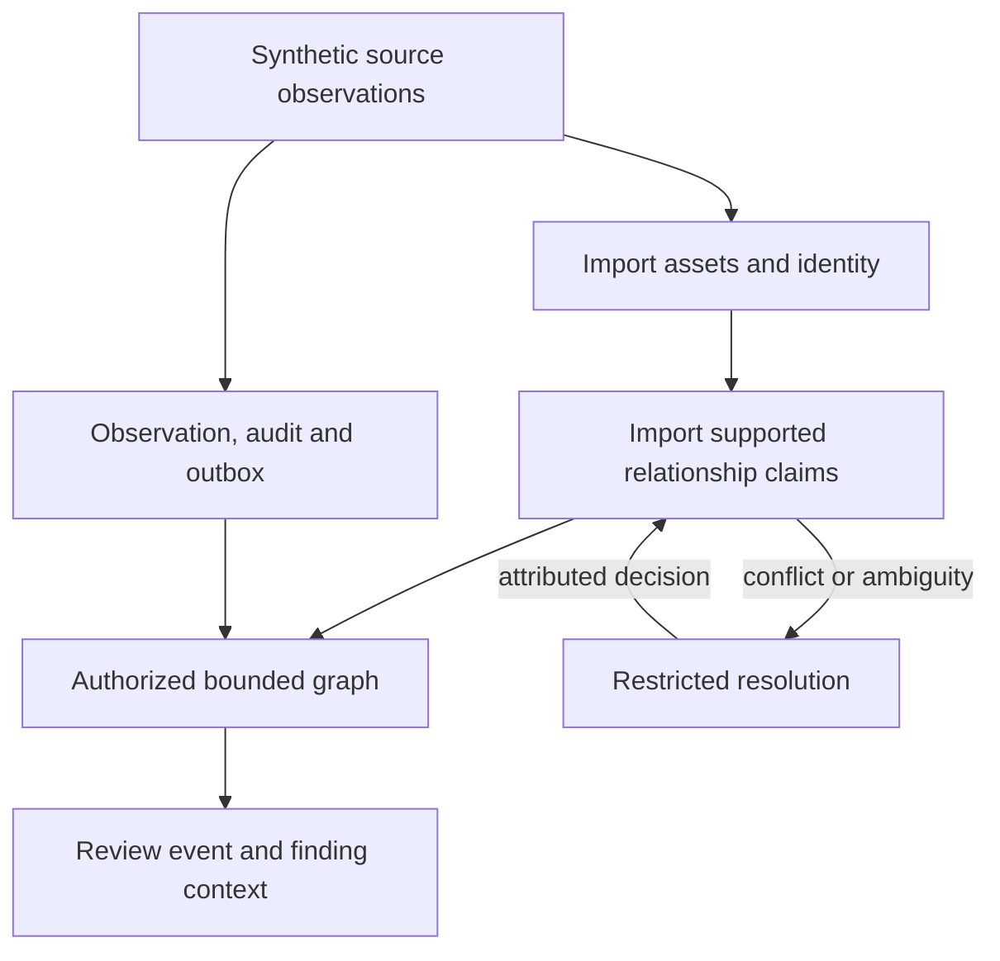

# QASCP 2.0 — Graph decision proposals G-01 through G-07

Status: proposed P1 design, 2026-11-15 (Qatar). Package V2-P1-02; review P1-V02. These proposals refine the [graph plan](QASCP_2_GRAPH_PLAN.md) and are not an approved ADR, executable API or phase-exit decision. Actual owners and independent reviewer: assignment pending. The [handbook](../governance/ENGINEERING_GOVERNANCE.md) and [authority matrix](QASCP_2_SUPERSESSION.md) retain precedence.

Requirements: PRD-01..04, PRD-06, PRD-09, PRD-10; QASCP-GOV-001..004, QASCP-SEC-001..005, QASCP-AI-002, QASCP-ENG-002. Affected paths: inventory/identity import, relationship claims, observation provenance, consumer receipt identity, temporal graph projection, cursors and future historical review. Acceptance in P1: review the concrete choices and rejection cases below, resolve listed compatibility changes and record the reviewer disposition. P2 runtime delivery still requires P1 approval.

## Executive decisions / القرارات المقترحة

| Gap | Proposed decision | Remaining acceptance |
|---|---|---|
| G-01 | Import resources and relationship claims using distinct authorized domain commands; resource co-occurrence never creates an access claim. | Adopt machine-readable command schemas and versioned API definitions before implementation. |
| G-02 | Qualify accesses as entitlement or observed_use; preserve each source's claim. | Approve Edge response/provenance compatibility and minimum disclosure policy. |
| G-03 | Deduplicate an event per tenant, logical consumer, consumer version, purpose and input version. | Approve receipt contract extension and retention profile. |
| G-04 | Maintain append-only claim versions with separate source-valid and knowledge time. | Approve temporal transition schema and history API before their delivery. |
| G-05 | Use policy-filtered, snapshot-bound traversal with deterministic edge order and bounded direction. | Approve graph response extension and security review. |
| G-06 | Use a common typed resource registry with enforced one-to-one authoritative domain rows. | Independently review database constraints, roles and deletion behavior before migrations. |
| G-07 | Use named workload profiles and report correctness, freshness and cost separately. | Product/platform owners approve numeric thresholds; no benchmark is claimed. |

المقترحات تحسم اتجاه التصميم كي يصبح قابلًا للتحويل إلى عقود واختبارات. «مقترح» لا تعني أن المراجع وافق، أو أن العقد الحالي تغير تلقائيًا. لا ننقل بيانات العملاء إلى بيئة التطوير.

## G-01 — Separate inventory from relationship intake

Choose two logical command families, ResourceImport and RelationshipClaimImport. They are proposed service operations, not new HTTP endpoints in the current OpenAPI. Only the registered integration principal may submit them, with the exact tenant and source capabilities allowed by its registration. Human-maintained data uses a separate authenticated, audited domain operation; it cannot impersonate a connector.

### ResourceImport v0.1 proposal

| Field | Proposed rule |
|---|---|
| schema_version | Exact command version; initially 0.1, independently versioned from observations 1.0 |
| command_id | Source-scoped nonempty stable string, at most 256 characters; unique across both import command families within the connector |
| connector_id | UUID matching the authenticated registration; never a source of tenant authority |
| observed_at | Source observation time in UTC RFC3339 |
| resource | Strict typed union; resource_kind plus stable source_id; no caller tenant_id or canonical resource UUID |
| expected_version | Required positive integer for mutation of an existing canonical record; omitted only for creation |
| evidence_event_id | Existing source_event_id in this connector's tenant/source scope; the observation must exist and be authorized |

For P2 the resource union supports only asset and identity. Asset fields: asset_kind (application, database, service, endpoint or dataset), display_name (1..256), classification (public, internal, confidential or restricted) and criticality (unknown, low, medium, high or critical). Identity fields: identity_kind (human or service), issuer and stable subject (1..256 each), display_name (1..256), status (active, disabled or unknown). Required attributes are explicit; unknown criticality/status is not converted to a favorable value. Finding, event and AI-system authoring remain their own phase/domain contracts.

Each command references the evidence observation that justified it. Import does not silently create that evidence or manufacture an observed_on edge. A source snapshot outside /observations needs its own authorized evidence-registration contract before adoption. Reject unknown command fields and unsupported domain kinds. Do not accept secrets, tokens, customer database contents or arbitrary metadata blobs.

Bootstrap ordering must avoid a circular dependency: an authorized observation may retain syntactically valid, unresolved same-registration source references as pending resolution without creating assets or edges. Its observation/receipt/audit commit is durable, but graph publication waits for authorized resource imports. ResourceImport then references that existing observation, establishes the binding, and a scoped resolver can project observed_on. No cross-source existence lookup or implicit resource creation is allowed. This pending-resolution behavior needs explicit adoption in the intake contract before implementation; 201 intake acceptance cannot be represented as completed entity resolution. Ingesting pending observations remains subject to quotas, expiry and operator review.

ResourceImport creates or updates a source binding and a new domain version. It cannot merge resources across connectors or reassign a reused source ID automatically. Reassignment and cross-source resolution require their own audited resolution decision. Attribute changes use expected_version; a stale version returns a conflict. Updates from competing sources are retained per source, with a reviewed field-authority policy deciding the canonical view; last writer does not silently win.

### RelationshipClaimImport v0.1 proposal

| Field | Proposed rule |
|---|---|
| common command fields | schema_version, command_id, connector_id, observed_at and evidence_event_id as above |
| source / target | Typed source references `{resource_kind, source_id}` within this registration; no arbitrary canonical UUID or connector selector |
| relation | Existing allowlist only; reject prohibited endpoint-type pairs |
| qualifier | Required for accesses; exact entitlement or observed_use; absent for relations that do not define one |
| valid_from / valid_to | UTC instants; optional valid_to must be strictly later than valid_from |
| source_claim_id | Stable source claim identity, 1..256 characters; new versions refer to this claim lineage |
| expected_version | Required for correction/retraction; absent for a new claim |
| operation | assert, correct or retract; correction/retraction identifies the prior claim version |

The adapter computes the command payload digest over received entity bytes using the observation intake convention. Idempotency scope is `(tenant, connector, command_id)` across both families. Same key/digest returns the prior receipt; different digest conflicts. Sensitive domain, audit and outbox changes commit atomically. Rejected or unauthorized commands never disclose whether another tenant has that resource. Missing same-scope references return a generic unresolved-reference error; they never trigger implicit asset creation.

For P2 authorize owns, runs_as and accesses with asset/identity endpoints. observed_on is owned by the observation resolver. affects is delivered with findings in P3; evidence/assertion/control relationships arrive in P5. The schema allowlist is not permission to invoke a future phase's domain.

Suggested HTTP semantics when the API contract is adopted: 201 accepted new command, 200 identical replay, 409 digest/version conflict, 422 malformed typed fields or prohibited pair, 403 unauthorized registration/capability, 404 absent or invisible evidence/resource, 429 configured quota, 503 required durable service unavailable. Use the existing generic error/correlation convention. Apply a reviewed per-command body bound no greater than the current 1 MiB intake bound; batching is deferred so each receipt has a precise atomic unit.

Cross-source relationships use a separate authorized resolver after both endpoints have stable bindings. The resolver records input observation IDs and rule/resolution-decision version. A connector cannot claim authority over an unrelated source merely by including its identifier.

## G-02 — Entitlement differs from observed use

Choose accesses plus a mandatory qualifier in the domain claim. Entitlement means an authorized source reported a grant; observed_use means a source reported activity. Neither means compromise. An IAM snapshot can establish entitlement; a database audit observation can establish observed_use. The projector must not convert one into the other. BANK-01 needs a finding or reviewed policy assessment to establish that an entitlement is excessive.

Keep conflicting grants/activity claims separately attributable. A summarized line may group only claims with the same endpoints, relation, qualifier and visible source scope. It shows source count only after authorization; it must not reveal a hidden claim through a count or confidence change. Do not average confidence across unrelated source methods.

Compatibility proposal: retain the current Edge response untouched until an adopted version adds qualifier and a restricted provenance summary, with explicit client compatibility review because the current schema uses additionalProperties:false. First-slice clients may inspect authorized provenance, but must abstain from interpreting an accesses edge when its meaning is unavailable. A graph-read permission alone cannot reveal confidential source payloads.

## G-03 — Event-specific receipts and controlled reprocessing

Choose receipt uniqueness on `(tenant_id, event_id, logical_consumer_id, consumer_version, purpose, input_version)`. logical_consumer_id is stable across worker replicas; consumer_workload_id remains the actual authenticated execution identity. A replica restart never creates a new logical consumer. Receipt PK remains its own UUID. The version fields describe the specific projection algorithm and input interpretation, not just a constant schema version shared by all events.

| Delivery | Expected behavior |
|---|---|
| Same event/version/purpose on another worker replica | One committed logical effect; return existing receipt |
| Different event, same consumer and schema version | Process independently; never suppress the second event |
| Same event intentionally projected by consumer version 2 | Separate versioned projection only through an authorized rebuild/reprocessing run |
| Delivery after authorization revoked | Deny/quarantine without reading restricted payload; no successful receipt |
| Crash after graph commit but before queue acknowledgment | Receipt and projection were committed together; replay does not duplicate claims |

Consumer version 2 writes a separate projection generation until verified and atomically activated; two generations cannot duplicate the visible domain facts. A rebuild cannot rerun an operational response or approval consumption. The proposed logical_consumer_id/consumer_version fields require a consumer-receipt schema version change. Existing schema 1.0 is not silently reinterpreted.

Retention choice: define replay_window per registered source before intake is enabled. Keep idempotency receipts and referenced lineage for at least that window, within an approved evidence-retention policy. Reject an expired-window replay from the ordinary path; only an authorized reconciliation run can import it with explicit scope and provenance. Do not solve retention expiry by executing old messages as new commands.

## G-04 — Append-only claim transitions and two clocks

Choose ClaimVersion plus ClaimTransition records. ClaimVersion has tenant, claim_id, version, typed endpoints, relation/qualifier, evidence observation, valid interval, recorded_at, source/rule versions and payload digest. ClaimTransition has tenant, transition_id, claim_id, expected_version, new_version, operation, prior-version reference, reason, actor/context and recorded_at. A transition and its audit commit atomically. Corrections are scoped to their own source lineage; one connector cannot retract another source's claim.

Record source-valid time as half-open intervals and knowledge time as server-committed recorded_at. No public client may backdate recorded_at. Keep prior versions immutable. A retraction can state the corrected source interval and does not erase the earlier known view. If later source evidence describes an earlier effective change, it is a late correction rather than a silent rewrite.

For a query at valid_at V and known_at K: first select versions/transitions recorded no later than K, resolve the effective lineage within that known set, then select facts whose source-valid interval contains V. A future correction must not suppress an old claim in a historical known_at view. Apply current access policy to every returned fact and provenance reference. A historical permission does not revive revoked access.

Concurrent corrections require expected_version; only one transition wins. A conflict preserves both source observations for authorized review while recording no second successful transition. Cycles in asset dependencies are allowed as source facts but traversals terminate on visited typed IDs. Assertion dependency cycles are rejected until an explicit evaluation policy defines their semantics.

History compatibility: add separate valid_at and known_at parameters only through an adopted graph/history contract. Current as_of is proposed to mean the projection's knowledge cutoff, not simultaneously source time and completeness. Until that change is accepted, callers cannot rely on an undocumented dual-time query.

## G-05 — Safe, repeatable graph pages

Choose default direction both for investigation, explicit incoming/outgoing/both selector, depth 1..2, and maximum 200 returned edges with 201 nodes. Direction changes must be in the future query contract; existing clients receive only existing behavior until that contract is adopted.

For each request: authorize root and graph operation; select a projection generation and knowledge cutoff; expand with node/edge/provenance policy at every hop; enumerate visible edges by `(hop, edge_id)` and nodes by stable ID. Duplicate edges across hop discovery use their minimum authorized hop. Track visited IDs to terminate cycles. Authorization is applied before frontier expansion, sorting, counts and continuation. No traversal through hidden intermediates is permitted.

Enforce the 201-node bound independently from the 200-edge bound. A later page can contain disjoint depth-two edges whose parent edges were on an earlier page; 200 edges do not automatically imply at most 201 endpoints on that page. Include the root and every returned edge endpoint, stop before either bound is exceeded, and continue from the first unreturned edge. Return fewer edges where needed rather than dropping endpoints or exceeding the node limit.

Pages share a snapshot, root, query and current authorization version. Use a server-managed snapshot token with configured expiry, rather than keeping a database transaction open across HTTP requests. Snapshot storage is tenant/principal scoped and includes only authorized data. The cursor is opaque and signed and binds generation, cutoff, direction, depth, limits, last ordering key, tenant, principal, authorization version and expiry. A changed authorization version invalidates the cursor; the caller starts a fresh authorized snapshot. Revocation is rechecked on every request.

Proposed response metadata: snapshot_id, knowledge_cutoff, generation_id and source_health summary scoped to authorized registrations. projection_state is current, lagging or unknown, relative to recorded source checkpoints; it is not a claim of knowing every event in the world. A cutoff does not imply completeness. Keep truncated/next_cursor semantics and explicit endpoint completeness. If the visible response exhausts a compute budget, return a documented retryable error rather than complete-empty data or a fabricated continuation. Full provenance and concealed source health cannot leak through aggregate metadata.

Snapshot expiry invalidates the cursor with a documented restart error. Source payload deletion or access change invalidates affected snapshots. Snapshot retention and principal-specific storage budgets are deployment inputs. RLS and resource policy still apply when snapshots are read; cached authorization is never the final decision.

## G-06 — Canonical registry and ownership constraints

Choose one Resource registry keyed by `(tenant_id, id)` with immutable kind. Each domain table has the same tenant/id plus fixed kind and a composite FK to `(tenant_id, id, kind)` in the registry. The registry has a corresponding unique key. Enforce exactly one authoritative domain row for every committed registry entry using deferred integrity checks plus restricted domain write procedures/roles. A bare polymorphic resource_id with an unchecked string kind is insufficient.

| Kind | Authoritative owner | Phase |
|---|---|---|
| asset / identity | Inventory / identity-metadata module | P2 |
| event | Observation/intake module | P2 |
| finding / case / risk | Finding and investigation modules | P3 |
| ai_system | AI inventory module; same-tenant underlying asset reference | P4 |
| evidence / assertion / control | Evidence/assurance/adopted-control modules | P5 |

An event may have an inventory reference before its richer domain is implemented; it cannot create a registry node of an unsupported kind. The graph projection owns only its claims/read model and cannot bypass authoritative domain writes. Each endpoint, source binding, evidence reference and supersession reference carries same-tenant FKs. Cross-tenant references fail even if IDs happen to match.

Runtime roles cannot own tables, bypass RLS or invoke unrestricted SECURITY DEFINER functions. Any constrained database function requires fixed search_path, explicit execution privileges and independent review. Resource retirement normally closes source-valid records and prevents new use; physical deletion follows approved retention/legal-hold rules across objects, snapshots, projections and backups. An erase operation cannot leave dangling edges or retain unauthorized payloads merely to preserve a hash. Audit minimization and deletion requirements must be reconciled by the regulatory owner for the actual deployment.

## G-07 — Workload and evidence profiles

Choose profile LAB-GRAPH-01 as the proposed benchmark: two synthetic tenants, 10,000 nodes and 50,000 claims each, 10 events/second for 30 minutes, plus a 100 events/second 60-second burst. Preserve the PRD candidate targets: p95 bounded lookup <=500 ms, intake acknowledgment <=1 s, projection lag <=10 s. These numbers require owner approval before acceptance and are not measured results.

Record CPU/RAM/storage, database/OS/application versions, RLS roles, indexes, source mix, payload sizes, relation fanout, dataset seed/version, concurrency, warm/cold cache condition and timing method. Run sparse, high-fanout, cyclic, conflicting-source and lagging-source cases, including one tenant saturating its quota while the other makes permitted requests.

Report successful/failed requests and denominators, p50/p95/p99 latency, throughput, queue depth, projection lag, query budgets, snapshot memory/storage, replay receipt growth and restore/rebuild duration. Report cross-tenant leaks, hidden-hop leaks, lost events, duplicate effects and missing audits separately from performance. Missing events do not count as improved latency. A correctness failure blocks acceptance regardless of speed.

Conflict policy: source assertions remain separate until an approved precedence rule or attributed human resolution establishes the canonical conclusion. The lab compares presentation with expected source claims, not an invented universal risk score. Runtime retention windows and recovery targets remain deployment decisions; owner approval is still required.

## BANK-01 design acceptance sequence

| Step | Expected result | Phase / existing package |
|---|---|---|
| Import assistant-01 asset, db-01 asset and svc-01 identity using separate source observations | Three same-tenant registry/domain records and source bindings, with synthetic metadata only | P2 / V2-P2-02 |
| Import runs_as and entitlement accesses claims with evidence_event_id | Two attributable claims; co-occurrence creates none | P2 / V2-P2-03/04 |
| Ingest activity e-01 referencing svc-01 | One observation and authorized observed_on resolution; replay has one effect | P2 / V2-P2-04/05 |
| Issue two different event IDs under the same schema/consumer version | Both are processed and have distinct receipts | P2 / V2-P2-04 |
| Tenant B reuses display/source IDs and guesses tenant A UUIDs | No cross-tenant records, paths, counts or evidence revealed | P2 / V2-P2-05/06 |
| Ingest excessive-access finding and build a case | Rule basis and source evidence are explicit; a grant plus activity alone does not establish exfiltration | P3 / V2-P3-01 |
| Generate AI suggestion and synthetic approval/execution | Model cannot mutate trusted claims or grant execution permission | P4 / V2-P4-01/02 |
| Correct/expire supporting permission evidence | Historical view preserved; affected assertion needs fresh verification | P5 / V2-P5-01 |

These cases are planning criteria, not executed runtime tests. P2 covers only its authorized part; the scenario's P3–P5 actions remain behind their own phase gates.

Machine-readable P2 resource/relationship command candidates are now specified in [Graph import contracts](QASCP_2_GRAPH_IMPORT_CONTRACTS.md). They remain proposals; other listed contract extensions remain separate work.

## Review and compatibility checklist

All seven gaps now have a concrete proposal; none has an attributed approval. Independent review must check resource/relationship command schemas and expected-version rules, receipt uniqueness/rebuild semantics, qualifier compatibility, temporal lineage/cutoffs, snapshot revocation/cost, registry integrity and source retention. Adopt machine-readable schemas and update affected OpenAPI/internal-contract versions in a separate scoped P1 change before implementation; do not reinterpret existing 1.0 records in place.

Original design provenance: derived from the owner's vision, the graph plan and the current repository contracts. No external schema/code/taxonomy was copied; no new external dependency, regulatory rule or novelty claim is adopted. Numerical targets are inherited proposed PRD values. This document creates no extra backlog or assumed regulatory applicability.

## Local preparation evidence

Prepared over main 9c784ae465e2fec87b091f671df1c76f172e0613 (tree f4d8bdd286017db8ec97c380f5531ab265fbd9ba). The isolated review package contains this document, a link in the graph plan and its REQUIRED_FILES entry. Existing local contract and test edits are excluded. Validation results are recorded in the pull request against its exact candidate. No runtime behavior or phase approval is claimed by document checks.

Validation on the isolated package (Windows, Python 3.14.4): C:/Python314/python.exe -B scripts/verify_foundation.py passed (exit 0); C:/Python314/python.exe -B -m unittest discover -s tests -v returned exit 1 with 16 passed and one WinError 1314 symbolic-link privilege error, no skipped tests. No full schema or runtime tests are claimed for this prose-only proposal. Fresh Linux Actions results and independent review remain required.
