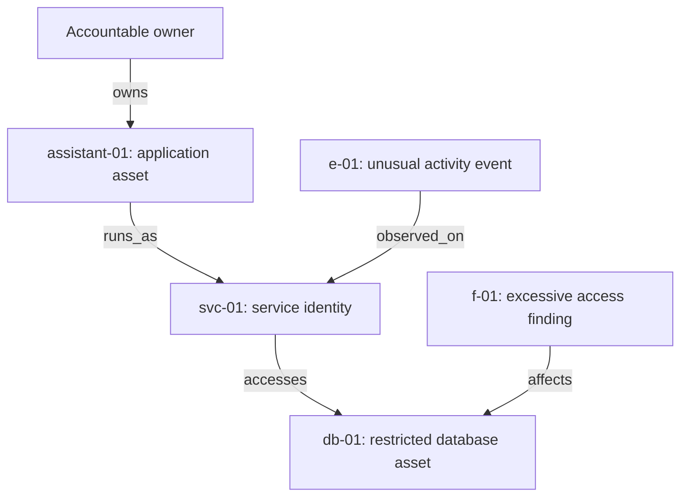
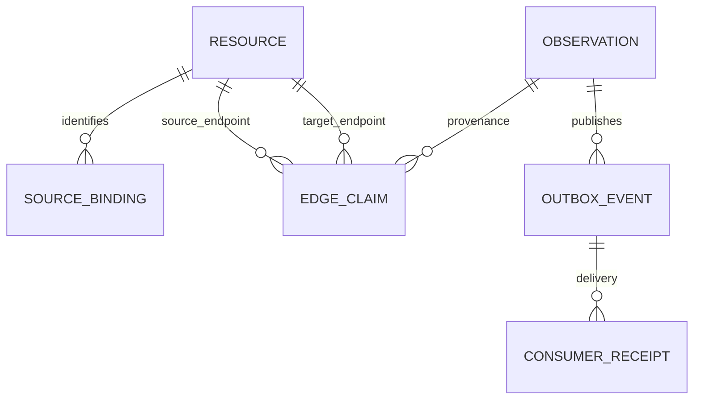
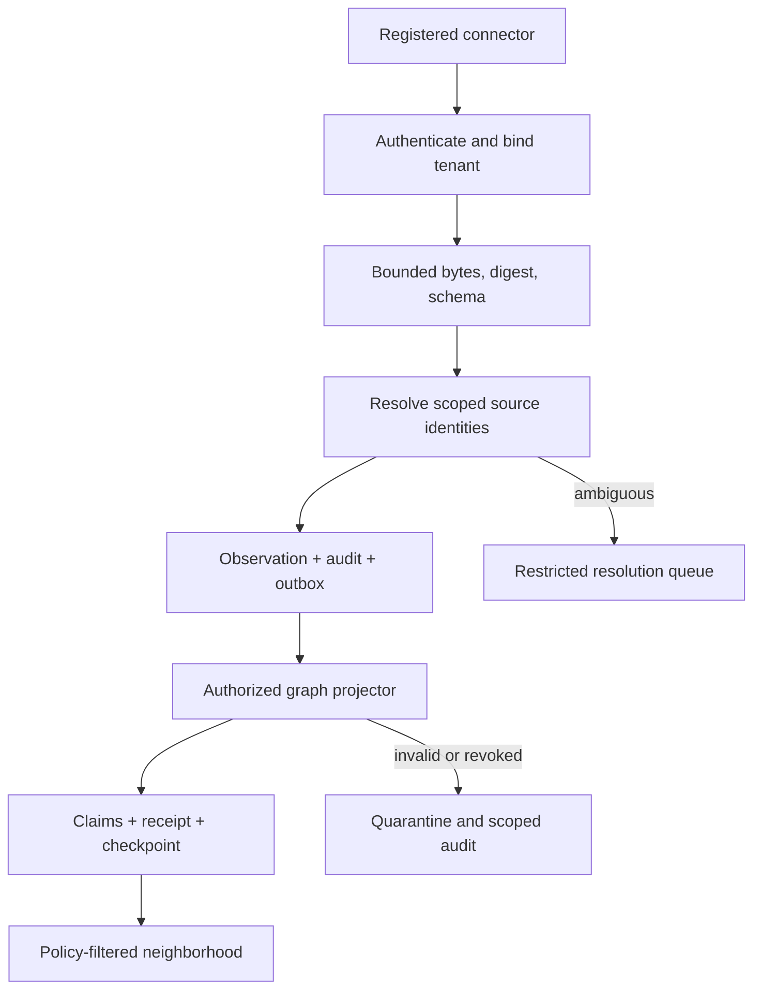
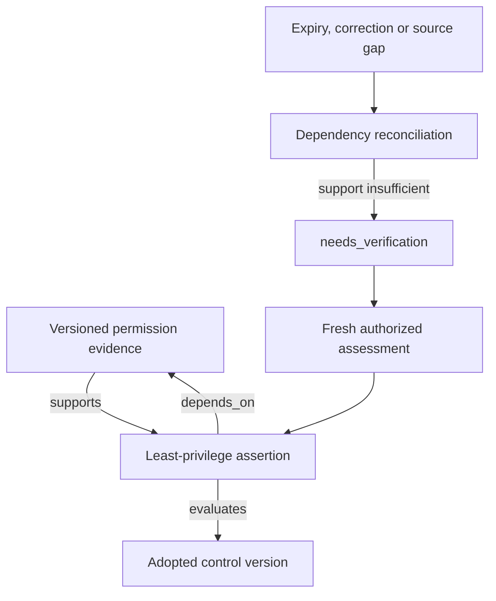

# QASCP 2.0 — Security Knowledge Graph design plan

Status: proposed P1 design extension, 2026-11-15 (Qatar). Implementation, migrations and approval are not delivered by this document. This plan refines [ADR-2-002](QASCP_2_ARCHITECTURE.md) under the [authority matrix](QASCP_2_SUPERSESSION.md); it does not supersede the handbooks or the [static contracts](QASCP_2_CONTRACTS.md). Owner and independent reviewer: assignment pending.

## Purpose and acceptance scope

Reconciliation note, 2026-11-16: the [import](QASCP_2_GRAPH_IMPORT_CONTRACTS.md), [receipt/history](QASCP_2_GRAPH_RECORD_CONTRACTS.md) and [boundary 0.2](QASCP_2_GRAPH_BOUNDARY.md) packages now provide versioned static candidates for G-01..G-05. References below to absent fields or contracts describe the preserved original API/receipt. These proposals still require independent review, explicit adoption and compatibility decisions. The bilingual [BANK-01 blueprint](QASCP_2_BANK01_BLUEPRINT.md) consolidates logical storage, transaction/crash boundaries and BA01..BA11 planned acceptance under the existing backlog.

العلاقة في QASCP ليست خطًا بين عنصرين فقط؛ إنها معلومة لها مصدر ووقت وصلاحية ونطاق وصول. هدف الرسم المعرفي هو إظهار كيف يرتبط الحدث بالهوية والأصل والنتيجة الأمنية، ثم استخدام هذه الروابط في التحقيق والضمان، مع إبقاء نقص الأدلة والتعارض ظاهرين.

Active work: P1 / V2-P1-02 / P1-V02. Requirements: PRD-01, PRD-02, PRD-03, PRD-04, PRD-06, PRD-09, PRD-10; QASCP-GOV-001, QASCP-GOV-002, QASCP-SEC-001 through QASCP-SEC-005, QASCP-AI-002, QASCP-ENG-002. P1 acceptance of this proposal requires independent review of entity identity, permitted relation types, provenance, time semantics, authorization before traversal, recovery and unresolved contract decisions. Earlier paths affected: observation normalization, source binding, outbox/receipt identity, graph API, case explanations and later assurance dependencies.

## 1. Three linked views

| View | Question | Delivery boundary |
|---|---|---|
| Security context | Which observed identity, system and exposure relate to this event? | P2 stored relationships; P3 correlation and cases |
| Assurance dependencies | Which versioned evidence supports this assertion, and what changed? | P5 |
| Decision history | Which rules, model suggestions and human decisions were used? | P3 case history, P4 approval boundary, P5 assurance history |

These are views of attributable records, not three independent sources of truth. The graph cannot grant access, certify compliance or authorize execution. A connected path is not proof of exploitation, compromise or data exfiltration.

## 2. BANK-01 security graph

All records below are synthetic, inside one tenant. Stable display aliases are explanatory names, not database identifiers. Each edge has its own authorized source observation.

The AI system record references assistant-01 as its underlying asset. P2 may store generic inventory/source metadata; model/tool/dataset governance is P4. Do not create a second unrelated application just because an AI inventory arrives later. The finding may describe an entitlement problem, a configuration issue or a vulnerability; its finding type and basis distinguish these. The event/finding relationship is reviewed or rule-derived at P3, rather than invented from proximity in the drawing.

## 3. Node types and canonical identity

Preserve the existing OpenAPI Node.kind values. Business services, databases, endpoints, datasets and applications initially use Asset with a versioned asset subtype, not new public node kinds. A new subtype still requires its domain import contract before ingestion.

| Node kind | Canonical record / key | Important scope |
|---|---|---|
| asset | Tenant-owned asset UUID | Kind, criticality, classification, owner reference and source bindings |
| identity | Tenant-owned identity UUID | Human/workload kind, issuer, subject and status; no tokens |
| finding | Tenant-owned finding UUID | Source finding ID, finding type, affected asset and assessment basis |
| event | Tenant-owned observation/event UUID | Connector/source event ID, payload digest and source/server time |
| ai_system | Tenant-owned AI system UUID | Underlying asset reference; model/tool/data metadata at P4 |
| case / risk | Tenant-owned domain UUID | Versioned explanations and linked resources at P3 |
| evidence | Tenant-owned evidence UUID | Authorized object reference, digest, custody and expiry |
| assertion / control | Tenant-owned assertion or adopted control UUID | Policy/control version and scoped assessment at P5 |

Entity identity is `(tenant_id, resource_id)`. External source identity is `(tenant_id, connector_id, resource_kind, source_id)`. Never match across tenants, by display name alone, or by a mutable IP address alone. A cross-connector link requires a reviewed mapping or a documented rule with stable input identifiers, version and confidence. Keep uncertain matches in a restricted resolution queue; they do not become traversable production relationships until resolved under policy.

For source deletion, identifier reuse or reassignment, close the binding's valid interval and create a successor binding/resource where appropriate. Preserve the prior history. A new connector registration does not inherit an old connector's identities automatically. Multiple source bindings may reference one entity only with explicit identity-resolution provenance.

## 4. Relation type rules

Direction is meaningful. Reversed traversal for investigation is a query operation; it does not create an inverse claim. Each relation is potentially many-to-many; exclusivity must be a separately versioned domain rule.

| Relation | Permitted source → target | Meaning / limit |
|---|---|---|
| owns | identity → asset | Accountable ownership from an authorized source; not access permission |
| runs_as | asset → identity | Application/service runtime identity binding |
| accesses | identity → asset | Declared or observed access; mandatory provenance qualifier distinguishes entitlement from observed use |
| affects | finding → asset | Finding scope reported by an authorized scanner/reviewer |
| observed_on | event → asset or identity | Explicit source reference or versioned resolution rule |
| supports | evidence → assertion | Versioned supporting evidence; not proof that an assertion passed |
| evaluates | assertion → control | Exact adopted tenant control/policy version |
| depends_on | asset → asset; assertion → evidence | Declared service dependency or evaluation input; never automatic authority inheritance |

The distinction between permitted access and observed use is required before BANK-01 delivery. The original public Edge schema has no qualifier field; boundary 0.2 proposes it for accesses. Original-contract clients must abstain when authorized provenance does not establish the meaning. Adoption and compatibility review remain required. Case membership, proposal/approval references, framework mappings and AI-system-to-asset references stay in their domain records; do not invent new relation labels absent from the static API allowlist.

## 5. Relationship provenance and conflicts

Each persisted edge identifies tenant, edge ID, typed endpoints, relation, source observation, source-valid interval, recorded time and confidence. Internal provenance additionally records source registration, adapter/rule version, derivation method, input versions, source health and correction lineage. The service owns these fields; caller text cannot assert trusted tenant or rule identity.

Initially keep one edge claim per source observation and endpoint/relation fact. Two sources making the same claim remain two attributable claims; a visualization may group them only after authorization and must expose the distinct evidence. Do not silently collapse claims into a fact with one arbitrary observation_id. A source disagreement remains visible. A confidence of 1 is an association assessment, not a 100% probability that the claim is true or that compromise occurred.

Separate four things in storage and UI: source observation, deterministic derivation, model suggestion, attributed human decision. Model suggestions cannot create trusted graph facts. Accepting a suggestion requires an authorized, audited domain operation with independent supporting evidence.

## 6. Proposed logical persistence model

These are planning names and constraints, not executable SQL or an approved migration. PostgreSQL remains the first storage candidate. Domain modules own canonical data; the graph is a rebuildable projection with explicit source references.

| Logical record | Proposed constraints and ownership |
|---|---|
| Resource registry | Composite PK `(tenant_id, id)`; immutable kind. Each kind has an authoritative domain record. Enforce registry/domain consistency in the same transaction; generic JSON blobs do not replace typed domain validation. |
| Source binding | Same-tenant resource and connector FKs; scoped source identity; historical valid intervals and explicit reassignment. A unique active binding per source identity. |
| Observation | Unique `(tenant_id, connector_id, source_event_id)`; immutable received-payload digest, adapter version and normalized references; correction is a new observation. |
| Edge claim / versions | Same-tenant endpoint and observation FKs; relation/type rule; no dangling endpoints; immutable versions and explicit supersession/retraction history. |
| Derivation inputs | Same-tenant claim/observation references and exact input versions for every derived edge; no opaque unsupported AI conclusion. |
| Projection checkpoint | Tenant, projector version, source partition/checkpoint and completion state; a timestamp alone cannot prove complete intake. |
| Audit / outbox / receipt | Existing static contracts; atomic domain/audit/outbox commit and atomic projection/receipt commit. |

Plan indexes on tenant plus source/relation/target/time, a reverse endpoint index for permitted incoming traversal, the source-binding key, and observation replay keys. Evaluate the query plan with RLS and real application privileges. No BYPASSRLS, database-owner runtime role, unrestricted cross-tenant views or global tenant graph cache.

Resource import 0.1 and claim version/transition 0.1 now specify initial typed payloads and lineage. Registry enforcement, binding generations, source-field authority and derivation-input persistence still need implementation-level contracts and independent review before migrations; see B02/B06 in the BANK-01 blueprint.

## 7. Intake, commit and projection boundaries

Two transactions have distinct responsibilities: intake commits an accepted observation durably; projection commits graph changes and its receipt together. A 201/200 receipt does not promise the graph is already updated. Projection failure leaves an explicit pending/quarantined state, not a successful empty graph. In P2 a controlled projector can run without adding a broker; P3 introduces broker/workers under the existing backlog. Do not add an ungoverned in-process production task as a substitute for durable delivery.

The intake adapter hashes the received entity bytes exactly as the current contract specifies. Identical key/digest replay has one logical effect. A new event with the same resource references is still a new event and must not be discarded as a duplicate.

Receipt 2.0 proposes uniqueness by tenant, event, logical consumer, consumer version, purpose and input version. Deduplicating only by tenant/purpose/input version would drop unrelated events. The record proposal and fixture oracle now cover this identity; database concurrency, retention and adoption remain unverified. Receipt 1.0 is preserved rather than silently reinterpreted.

## 8. Time, corrections and historical truth

Use separate source-valid and system-knowledge time. Example: access was observed at 10:00, learned at 10:05, and corrected at 11:00 with a new claim applicable from 09:50. The as-known-at-10:30 view retains the earlier claim; a current review of source time 10:00 includes the later correction and its provenance.

Intervals are half-open `[valid_from, valid_to)`; absent valid_to means open-ended, not permanent truth. Retracting or superseding a claim records a new version/decision. An as-of view applies corrections only if their recording time is within its knowledge cutoff. Do not filter old rows out solely because a later correction references them. Historical access is checked against the viewer's current authorization, not their former permissions.

The original GET contract has one `as_of` field and no two-time query parameters. Boundary 0.2 proposes explicit valid_at, knowledge_cutoff and projection-state metadata and reserves valid_at/known_at selectors for authorized P5 history. Claim 0.1 corrections fully replace a source interval; terminal withdrawal and unsupported partial withdrawal are defined in the record proposal. Equal-time commit ordering, actual snapshot/history enforcement and adoption still require review and runtime tests. No running API capability is implied here.

## 9. Authorized traversal and presentation

Authenticate and resolve membership, then check graph:read and the root resource policy. Apply node, edge and provenance policy before expanding every hop and before deriving counts. Invisible intermediate nodes cannot be used to reveal a path between visible nodes. Same-tenant access alone does not grant access to restricted evidence. Do not return an edge if the endpoint or required provenance cannot be disclosed under the response policy.

Keep depth 1..2 and edge limit 1..200 per the current API. Define deterministic ordering on stable IDs and a consistent snapshot. A 200-edge page can need up to 201 nodes for a connected neighborhood, including its root; preserve bounds and endpoint completeness. Signed cursors bind tenant, principal/current authorization version, root, direction/filter, cutoff and expiry. Reauthorize each page and reject stale or altered cursors. Truncation requires next_cursor; a complete result omits it. Operational request budgets and timeouts must never be reported as a complete empty neighborhood.

UI: center on the event or selected identity; show its bounded neighborhood, evidence drawer, relationship explanation and timeline. Arabic RTL and English LTR share IDs and state values. Labels show observed/derived/suggested/reviewed plus freshness and conflict. Keyboard navigation and a table alternative are acceptance criteria. Avoid a single unexplained universal security score.

## 10. Assurance dependency view (P5)

The arrows from Change and Recheck are workflow flow, not new graph relation labels. The supports and depends_on links express evidence and dependency perspectives and must remain consistent in one domain transaction. An assertion's subject uses its domain reference; no undefined assertion-to-asset relation is introduced.

Selective invalidation uses the internal authorized dependency index, independent of what a limited user can see. Follow only recorded dependency semantics, not every graph neighbor. Expand the scope conservatively when dependency coverage or a source checkpoint is incomplete. Missing evidence yields needs_verification; failure requires an actual controlled test/assessment. A later human approval alone does not prove remediation. Fresh evidence and an attributed evaluation establish the new result. Compare selective and full evaluation on identical versioned fixtures at P5.

## 11. P2–P6 delivery and verification map

This table decomposes existing canonical work; it does not create a parallel backlog or authorize the next phase.

| Existing package | Graph contribution | Acceptance evidence |
|---|---|---|
| V2-P1-02 | Review this plan and its unresolved interface choices | P1-V02; named architecture/security disposition |
| V2-P2-01 | Tenant context, RLS, composite keys and scoped migrations | P2-V01/02; real PostgreSQL roles, pooled A/B reuse |
| V2-P2-02 | Resource registry and stable inventory/identity bindings | P2-V01; collision, reassignment, missing source cases |
| V2-P2-03 | Typed claims and bounded graph API | P2-V01; relation-type, provenance, hidden-hop and cursor tests |
| V2-P2-04 | Durable intake, audit, outbox and receipts | P2-V01/02; replay, digest conflict, crash and audit outage |
| V2-P2-05 / 06 | BANK-01 integrated path and bilingual graph view | P2-V01/02; two tenants, permitted views, accessible table |
| V2-P3-01 / 02 | Rule-derived correlation, cases, broker and replay | P3-V01 plus P2 regression; labeled errors, reorder and lag |
| V2-P4-01 / 02 | AI context and synthetic approval/executor boundary | P4-V01 plus earlier regression; suggestions cannot write facts |
| V2-P5-01..03 | Assurance graph, custody, authorized historical/export views | P5-V01; full/selective equivalence and cutoff authorization |
| V2-P6-01 | Approved load, restore/rebuild and enterprise review | P6-V01; independent review and exact artifact evidence |

Minimum future graph suite: same-tenant allow; cross-tenant read/write/reference denial; same names/IDs across tenants; forbidden type pairs; dangling provenance; identical replay; digest conflict; two different events at the same schema version; connector revocation; concurrent double processing; crash before/after each transaction; source reassignment; conflicting sources; late correction; expired evidence; hidden intermediate; cursor alteration/access revocation; projection lag; cyclic dependency termination; authorized rebuild and deletion/retention enforcement. These are planned cases, not executed runtime tests.

## 12. Open design decisions before implementation

Concrete proposals for G-01 through G-07 are recorded in [Graph decision proposals](QASCP_2_GRAPH_DECISIONS.md). Machine-readable candidates for G-01..G-05 now exist in the linked import/record/boundary packages. They remain proposed pending independent review and adoption; the table below retains original decision scope and required ownership, not evidence that those files are absent.

| ID | Gap or decision | Required owner and disposition |
|---|---|---|
| G-01 | Current /observations resource references cannot create inventory attributes, access grants or runs_as facts by themselves. Specify authorized inventory/relationship import commands and their typed schemas; never infer access from co-occurrence. | Inventory/integration lead + security reviewer; before V2-P2-02/03 |
| G-02 | Define accesses entitlement/usage qualifier and provenance disclosure policy; add a public field only through a compatible version decision. | Graph/domain lead + security reviewer; before V2-P2-03 |
| G-03 | Finalize receipt composite identity including event and consumer, projector-version replay and retention window. | Backend lead; before V2-P2-04 |
| G-04 | Define temporal supersession/retraction records and two-time/history contract; first-slice as_of cannot imply both meanings. | Graph/assurance lead; foundational lineage before P2, history contract before P5 |
| G-05 | Specify bounded query direction, snapshot ordering, cursor state and lag/completeness metadata. | API/security lead; before V2-P2-03 |
| G-06 | Map every node kind to a strongly enforced canonical domain record and ownership transaction. | Backend/database lead; before migrations |
| G-07 | Validate proposed laboratory profile, source conflict policy and retention/rebuild costs. | Product/platform owners; before performance acceptance |

All role assignments remain pending. These gaps do not prevent P1 design work; their disposition is part of independent P1 review. Approved phase exit is required before runtime implementation.

## 13. Sources and originality

This plan is original design reasoning derived from the owner's QASCP vision, the current PRD, architecture, contracts and product workflow. It uses no external project's schemas, proprietary taxonomy or interface. Historical PDFs provide context only; the repository's authority matrix controls current design. External standards, vendor comparisons and patents listed in [the research record](../research/QASCP_PRIOR_ART.md) are discovery/comparison references; they are not claimed fully revalidated here. [The source register](../governance/REGULATORY_SOURCES.md) owns regulatory edition, rights and applicability status. This graph design makes no patentability, novelty, certification or regulatory compliance claim.
